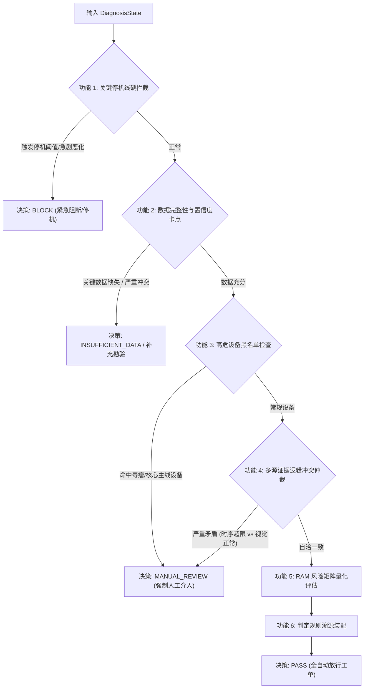

# Step 6 · 确定性安全门禁（Safety Guard）设计与功能规范

> **核心定义**：
> 安全门禁是 CentriPump-PHM 系统的**核心安全边界**与**非模型化控制层**。
> 本模块位于 Reasoner（综合推理）之后、Reporter（报告交付）之前，**严禁调用任何大语言模型（LLM）**，必须以 100% 纯确定性 Python 规则、RAM 风险矩阵与国标/企业技术规范为依据，对上游诊断结论与工程风险进行严苛卡点、安全阻断与分流决策。

---

## 1. 设计背景与定位

在工业离心泵机组的智能运维中，虽然大模型具备强大的语义归纳与多模态线索联想能力，但在工程落地中面临致命弱点：
- **概率漂移与幻觉**：同一工况可能因提示词微调产生不同归因，甚至给出脱离工程实际的盲目检修建议。
- **缺乏物理守恒与安全敬畏**：大模型无法承担工业现场设备损坏、介质泄漏乃至人员伤亡的安全连带责任。

为此，CentriPump-PHM 确立了 **“大模型给假设，确定性规则守底线”** 的核心原则：

```
上游 Agent 产出 (LLM)                  确定性安全门禁 (Step 6)                  下游报告交付 (Step 7)
┌──────────────────────┐              ┌────────────────────────┐              ┌──────────────────────┐
│  data      (时序特征) │ ──────────► │  rules/safety_guard.py │ ──────────► │  delivery (排查工单)  │
│  vision    (缺陷特征) │             │  rules/ram_matrix.json │              │  human    (人工复核)  │
│  reasoning (归因假设) │             │  rules/thresholds.py   │              └──────────────────────┘
└──────────────────────┘              └───────────┬────────────┘
                                                  │
                                                  ▼
                                      SafetyState (确定性硬判决)
                                      · decision: PASS / BLOCK / MANUAL_REVIEW...
                                      · risk_level: CRITICAL / HIGH / MEDIUM...
                                      · rule_hits: [RULE_01, RULE_02...]
```

> [!IMPORTANT]
> **红线规则**：
> 1. `safety.decision` 与 `safety.risk_level` 只能由 `rules/safety_guard.py` 计算产生，禁止任何大模型直接输出决策或修改该盒子。
> 2. 安全门禁必须能够无条件拦截、降级或否决上游 Reasoner 的任何高置信度结论。

---

## 2. 核心功能需求

安全门禁需实现六大确定性判定功能模块，各模块按照优先级顺序链式评估：



### 功能 1：极限工况与停机线硬拦截（Critical Trip Interception）
- **职责**：作为全系统最高优先级的安全跳闸判定，防范灾难性设备损毁。
- **输入判据**：
  - `data.threshold_flags` 是否包含停机线规则码：
    - `BEARING_TEMP_DE_TRIP`（驱动端轴承温度 $\ge 80^\circ\text{C}$，GB 50275 限值）
    - `VIB_DE_TRIP` / `VIB_NDE_TRIP`（驱动端/非驱动端振动有效值 $\ge 4.5\text{ mm/s}$）
    - `PRESS_IN_TRIP`（入口压力 $\le -0.055\text{ MPa}$，气蚀临界停机线）
  - 急剧恶化斜率：`BEARING_TEMP_DE_RAMP_SHARP`（温升斜率 $k \ge 0.8^\circ\text{C/min}$，干磨卡死先兆）。
- **动作响应**：
  - 输出 `risk_level = "CRITICAL"`；
  - 输出 `decision = "BLOCK"`；
  - 强制在工单中将操作建议置为“立即紧急切机排查，禁止带病维持运转”。

### 功能 2：数据完整性与低置信度硬卡点（Data Integrity & Confidence Gate）
- **职责**：防止在“信息真空”或“低可信度”状态下盲目推理下发工单。
- **判定规则**：
  - **空输入阻断**：若 `data.quality.status == "EMPTY"` 且 `vision.status == "NO_IMAGE"` 且工程师文本为空，直接判决为 `INSUFFICIENT_DATA`，中止自动派单。
  - **严重数据缺损**：若 `data.quality.status == "PARTIAL"`（采样覆盖率 $< 90\%$），且推理置信度为 `reasoning.confidence == "LOW"`，禁止全自动放行，转为 `MANUAL_REVIEW`。
  - **虚假输入利用拦截**：检查 `reasoning.used_inputs`。若 Reasoner 声称使用了 `data` 或 `vision`，但对应状态实际为 `EMPTY` 或 `NO_IMAGE`，判定存在输入幻觉，降级为 `MANUAL_REVIEW`。

### 功能 3：高危设备与核心管线黑名单卡点（High-Risk Asset Blacklist）
- **职责**：针对厂区主干管网、易燃易爆物料泵、孤品关键机泵等高敏感资产实施特权保护。
- **判定规则**：
  - 读取 `rules/ram_matrix.json` 中的 `high_risk_devices` 配置列表（如 `PUMP-A01-HEAVY-OIL`、`PUMP-MAIN-CIRC-01`）。
  - 若当前 `context.device_id` 属于该名单：
    - **最高放行权限限制**：无论 Reasoner 结论多明确（即便 `confidence == "HIGH"`），系统**永远不得给出 `PASS`**，最高只能为 `MANUAL_REVIEW`。
    - 记录规则命中 `RULE_HIGH_RISK_DEVICE_GUARD`，强制下发带双人签字确认的人工复核单。

### 功能 4：多源证据冲突仲裁（Multi-Source Conflict Arbitration）
- **职责**：识别并仲裁不同传感器/模态之间的物理逻辑矛盾。
- **典型冲突场景**：
  1. **物理超限与视觉矛盾**：时序数据显示 `BEARING_TEMP_DE_TRIP`（极度过热），但现场近景图片中轴承压盖漆面完好、无润滑油炭化痕迹，且红外测温仅显示常温。
  2. **电气满载与水力失压矛盾**：电机电流达额定上限（`CURRENT_HIGH`），但泵出口压力严重偏低且无流量（`FLOW_WARN_LOW_M3H`），疑似断轴或管路破裂。
  3. **模型主动上报矛盾**：`reasoning.conflicts` 列表非空。
- **动作响应**：
  - 触发 `RULE_EVIDENCE_CONFLICT`；
  - 决策锁定为 `MANUAL_REVIEW`，在报告中显式列出冲突证据对，指示一线工程师核对测点传感器状态。

### 功能 5：RAM 风险矩阵评级（RAM Risk Matrix Evaluation）
- **职责**：综合可靠性（Reliability）、可用性（Availability）和可维护性（Maintainability），确定性评估故障风险等级。
- **评级维度**：
  - **S（严重度 Severity）**：取决于是否越过预警线/停机线、是否存在跑冒滴漏（视觉 `CRITICAL`/`HIGH` 缺陷）。
  - **O（频次/紧迫度 Occurrence）**：取决于恶化斜率（急剧/缓慢）与当前运行状态（运行/降级/停机）。
  - **D（可控度/可测性 Detectability）**：取决于数据质量与证据支撑源数量。
- **RAM 矩阵映射表（`rules/ram_matrix.json`）**：
  | 风险等级（risk_level） | 适用场景特征 | 处置时效要求 | 对应准入决策 |
  | :--- | :--- | :--- | :--- |
  | **CRITICAL（一级特级）** | 超停机线、急剧恶化、易燃有毒介质泄漏 | 立即停机（<15 min） | `BLOCK` |
  | **HIGH（二级重大）** | 超预警线、高危设备异常、显著振动偏高 | 4 小时内就地处置 | `MANUAL_REVIEW` |
  | **MEDIUM（三级中度）** | 工况漂移、缓慢劣化、中轻度渗油 | 24 小时内排班检修 | `MANUAL_REVIEW` 或 `PASS` |
  | **LOW（四级轻微）** | 测点轻微波动、低置信度非核心缺陷 | 纳入定期点检计划 | `PASS` |

### 功能 6：100% 规则溯源与决策输出（Traceability & Decision Output）
- **职责**：生成机器可解析、人工可核查的完整安全裁决对象 `SafetyState`。
- **输出规范**：
  - `decision`：从闭环集合 `["PASS", "MANUAL_REVIEW", "BLOCK", "INSUFFICIENT_DATA"]` 中四选一。
  - `risk_level`：RAM 矩阵计算所得的标准风险级别。
  - `rule_hits`：命中的所有标准规则代码清单（如 `["VIB_DE_TRIP", "HIGH_RISK_DEVICE_GUARD"]`）。
  - `reasons`：面向工程师的中文清晰事实判据（如 `"驱动端振动 4.82 mm/s 超过国标停机线 (4.5 mm/s)，依据 GB 50275 附录 A 实施紧急停机阻断"`）。

---

## 3. 核心决策状态机

`SafetyState.decision` 是下游工单组装器（Step 7 Reporter）与工作流路由的核心输入分支依据：

```text
┌─────────────────────────┬─────────────────────────────────────────────────────────────────────────┐
│ 决策状态 (decision)      │ 下游对应动作与系统行为                                                    │
├─────────────────────────┼─────────────────────────────────────────────────────────────────────────┤
│ PASS                    │ · 生成常规闭环排查工单                                                   │
│                         │ · 可由自动化系统直接下发运维系统，无需人工在线审批                       │
├─────────────────────────┼─────────────────────────────────────────────────────────────────────────┤
│ MANUAL_REVIEW           │ · 生成待复核工单草稿，锁定自动派发通道                                   │
│                         │ · 流程进入 Human Review 挂起状态，必须工程师数字签字确认后方可释放       │
├─────────────────────────┼─────────────────────────────────────────────────────────────────────────┤
│ BLOCK                   │ · 触发安全告警，阻断常规检修建议流程                                     │
│                         │ · 自动生成紧急停机安全指令，高亮展示事故防范措施                         │
├─────────────────────────┼─────────────────────────────────────────────────────────────────────────┤
│ INSUFFICIENT_DATA       │ · 拒绝生成正式排查工单                                                   │
│                         │ · 生成现场复勘清单（补测振动、补充红外测温或补充现场照片）               │
└─────────────────────────┴─────────────────────────────────────────────────────────────────────────┘
```

---

## 4. 架构设计与实现接口

### 4.1 目录划分与职责边界
```text
CentriPump-PHM/
├── rules/
│   ├── thresholds.py       # 唯一数值阈值出处（已存在：额定值、预警线、停机线、规则码表）
│   ├── ram_matrix.json     # RAM 风险矩阵对照表与高危设备黑名单配置
│   └── safety_guard.py     # 【待实现】确定性安全门禁评判引擎核心
│
├── src/
│   ├── orchestrator/
│   │   └── nodes.py        # safety_guard_node 适配函数（解包 State → 调用引擎 → 回写 State）
│   └── schemas/
│       └── state.py        # SafetyState / HumanState 契约定义
```

### 4.2 引擎类设计（`rules/safety_guard.py`）

```python
class SafetyGuardEngine:
    """确定性安全门禁评判引擎（单例模式，纯 Python，零大模型调用）。"""

    def __init__(self, ram_config_path: Path):
        self.ram_config = self._load_ram_matrix(ram_config_path)

    def evaluate(self, state: DiagnosisState) -> SafetyState:
        """主入口：对当前全局状态执行安全门禁全量规则评判。"""
        # 1. 停机线与急剧恶化检查（功能 1）
        trip_hit, trip_reasons, trip_rules = self._check_critical_trips(state)
        if trip_hit:
            return SafetyState(
                risk_level="CRITICAL",
                decision="BLOCK",
                rule_hits=trip_rules,
                reasons=trip_reasons,
            )

        # 2. 数据有效性检查（功能 2）
        data_hit, data_reasons, data_rules = self._check_data_sufficiency(state)
        if data_hit:
            return SafetyState(
                risk_level="HIGH" if state.context.device_id else "LOW",
                decision="INSUFFICIENT_DATA",
                rule_hits=data_rules,
                reasons=data_reasons,
            )

        # 3. 高危设备管控（功能 3）
        is_high_risk = self._is_high_risk_device(state.context.device_id)

        # 4. 多源证据冲突判定（功能 4）
        has_conflicts, conflict_reasons = self._check_evidence_conflicts(state)

        # 5. RAM 风险矩阵综合评级（功能 5）
        risk_level = self._evaluate_ram_level(state, is_high_risk)

        # 6. 确定最终 decision 分流
        decision = self._derive_decision(
            risk_level=risk_level,
            is_high_risk=is_high_risk,
            has_conflicts=has_conflicts,
            confidence=state.reasoning.confidence,
        )

        return SafetyState(
            risk_level=risk_level,
            decision=decision,
            rule_hits=[...],
            reasons=[...],
        )
```

---

## 5. 测试与工程验收标准

安全门禁属于系统的红线模块，上线前必须通过以下场景的 **100% 确定性单测覆盖**：

1. **红线拦截单测**：构造时序包含 `BEARING_TEMP_DE_TRIP` 的状态，即使 Reasoner 给出“轻微磨损、建议加注润滑油”，安全门禁必须强制输出 `BLOCK` 并标记 `CRITICAL`。
2. **黑名单单测**：指定 `device_id` 为黑名单设备，无论其它输入如何完美，`decision` 绝对不可为 `PASS`，只能为 `MANUAL_REVIEW`。
3. **空输入拒止单测**：全空状态输入下，必须输出 `INSUFFICIENT_DATA`，不得生成任何合规工单建议。
4. **证据冲突拦截单测**：构造时序高温超停机线但视觉模型判定 `NO_DEFECT` 且 Reasoner 记录矛盾，门禁必须分流至 `MANUAL_REVIEW` 并清晰指出证据冲突。
5. **完全幂等性单测**：相同 `DiagnosisState` 输入连续运行 10,000 次，返回的 `SafetyState` 必须字符级完全一致。
